# Active Directory Identity & Access Management Lab

**Windows Server 2025 | Active Directory Domain Services | NTFS Permissions | SMB File Sharing | Role-Based Access Control**

## Project Overview

This project demonstrates the deployment and administration of an Active Directory environment using Windows Server 2025 and a domain-joined Windows client.

The lab simulates a small business environment with three departments: IT, Human Resources, and Accounting. Each department requires its own user accounts, security groups, and network file shares.

The objective was to implement centralized identity management, configure department-based file permissions, and verify that employees could access only the resources appropriate to their roles.

## Lab Environment

| Component | Configuration |
|---|---|
| Hypervisor | Oracle VirtualBox |
| Server Operating System | Windows Server 2025 |
| Client Operating System | Windows client |
| Active Directory Domain | vinintech.com |
| Domain Controller IP | 192.168.56.10 |
| Directory Service | Active Directory Domain Services |
| File Sharing Protocol | SMB |
| File System Permissions | NTFS |

## Project Objectives

- Create and organize Active Directory Organizational Units (OUs).
- Provision employee accounts and configure account properties.
- Create department-based security groups.
- Assign users to their respective security groups.
- Configure departmental file shares.
- Implement NTFS and SMB share permissions.
- Test authorized and unauthorized access from a domain-joined client.
- Verify file creation and modification permissions.

## 1. Organizational Unit Configuration

Created a departmental OU structure to organize users and security groups within the Active Directory domain.

The environment included organizational units for IT, HR, and Accounting under the USA organizational structure.

This approach supports centralized administration and separates departmental resources logically.

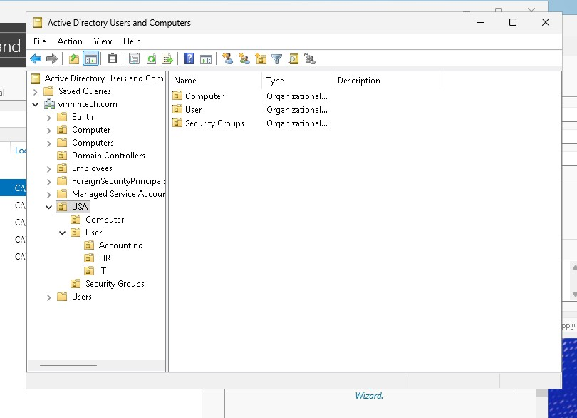

## 2. User Account Provisioning

Created and configured employee accounts for the simulated organization.

| Employee | Department | Role |
|---|---|---|
| James Wilson | IT | Help Desk Technician |
| David Smith | IT | IT Support Technician |
| Sarah Johnson | HR | HR Employee |
| Bob Ross | HR | HR Employee |
| Michael Brown | Accounting | Accounting Staff |

Configured user properties, including department information and job titles where applicable.

Account configurations included password-change requirements and account settings appropriate to the lab scenarios.

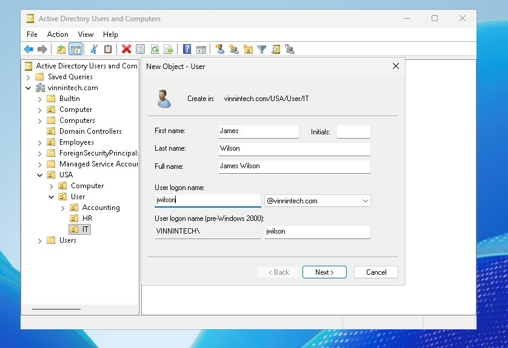
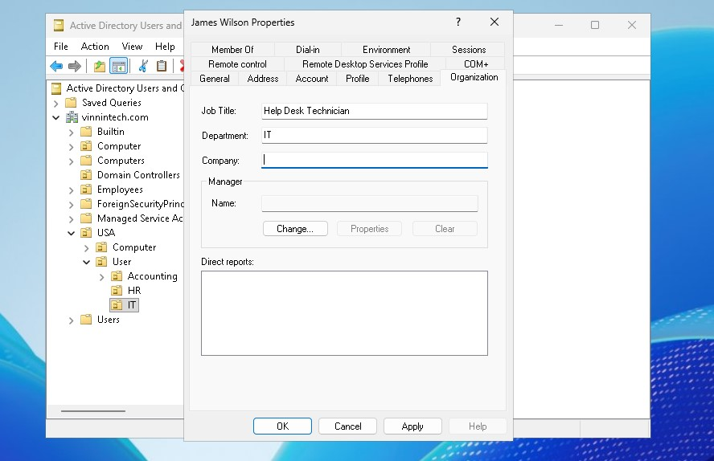

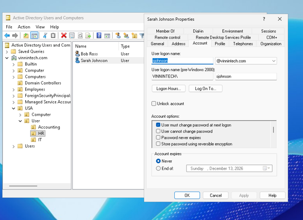
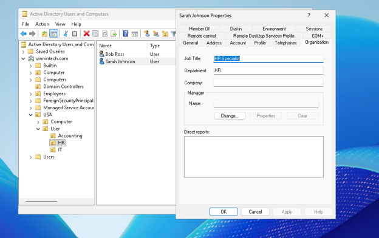

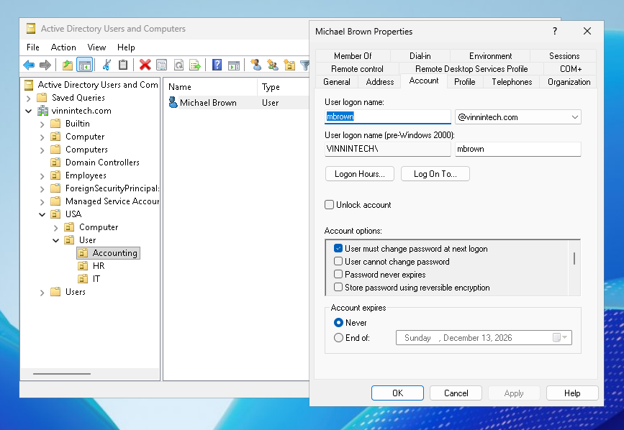
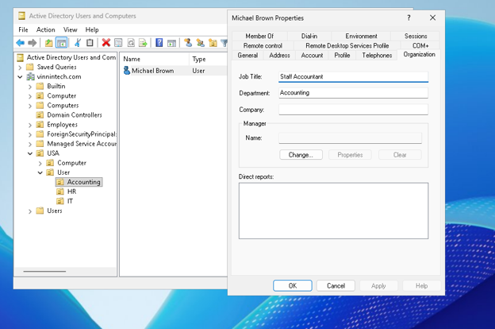
## 3. Security Group Configuration

Created three Active Directory security groups:

- SG_IT
- SG_HR
- SG_ACCOUNTING

  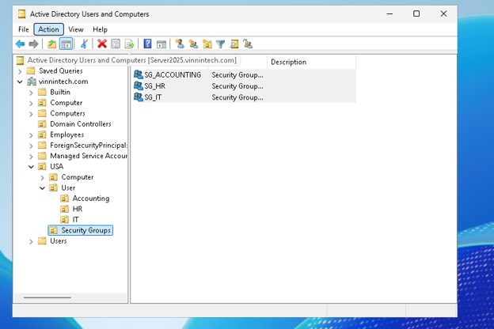

Assigned employee accounts to their respective departmental groups.
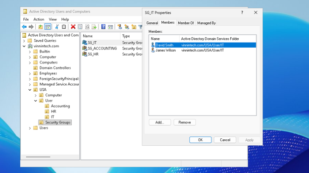
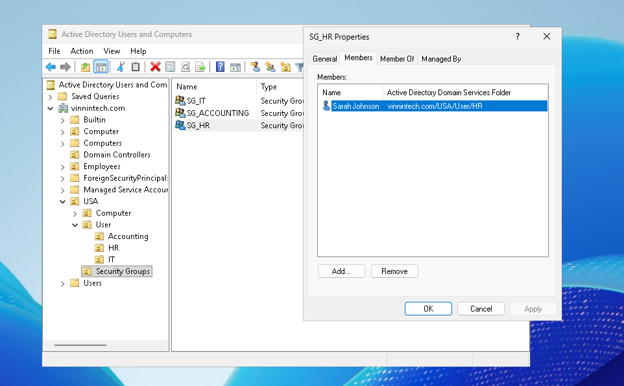
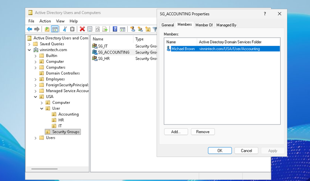

Using security groups rather than assigning file permissions directly to individual accounts simplifies access administration and supports role-based access control.

## 4. NTFS Permission Configuration

Created departmental folders under:

`C:\CompanyShares`

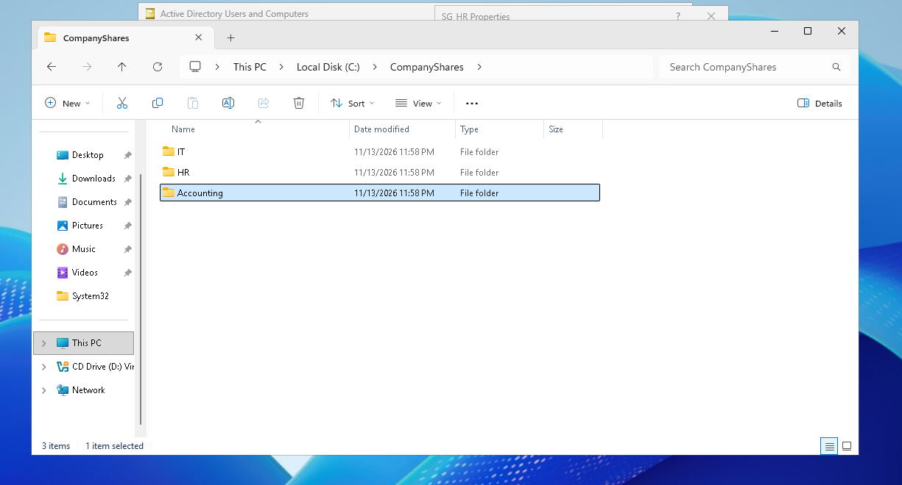

Configured the following permissions:

| Folder | Department Group | NTFS Access |
|---|---|---|
| IT | SG_IT | Modify |
| HR | SG_HR | Modify |
| Accounting | SG_ACCOUNTING | Modify |

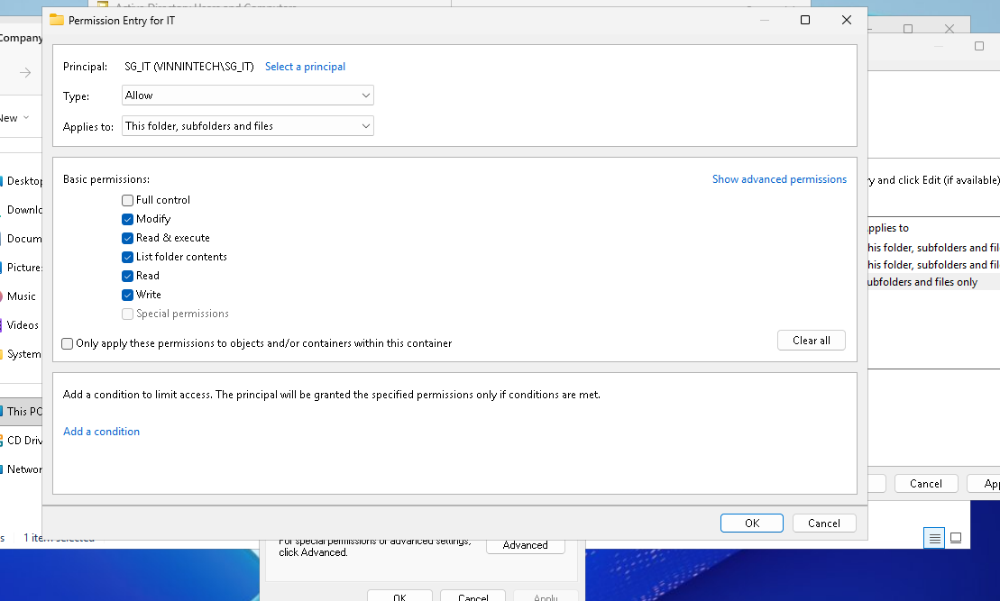

Retained administrative and SYSTEM permissions for server management.

Configured departmental access using the principle of least privilege, granting users the permissions necessary to work with their department's files.
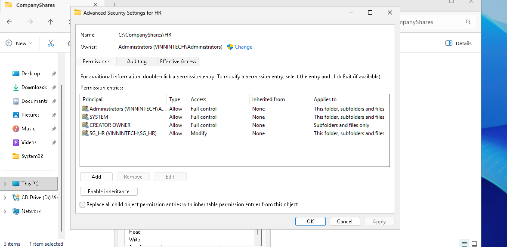

## 5. SMB Network File Sharing

Configured departmental network shares using Windows Server file-sharing functionality.

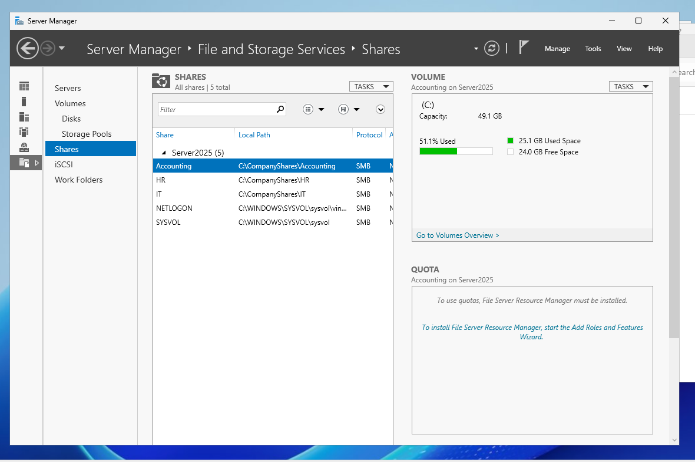

| Department | Network Share |
|---|---|
| IT | `\\192.168.56.10\IT` |
| HR | `\\192.168.56.10\HR` |
| Accounting | `\\192.168.56.10\Accounting` |

Configured departmental security groups with Change and Read share permissions.

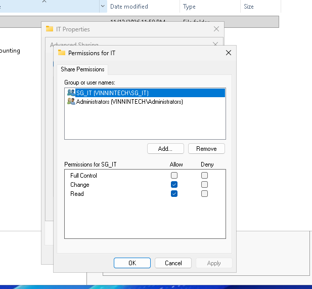
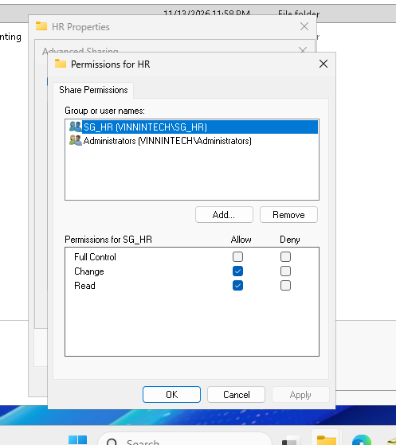
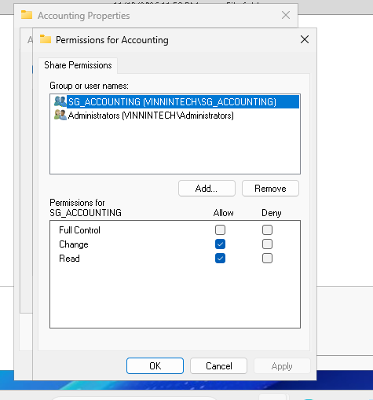

These permissions allow authorized employees to work with shared files while restricting access to users outside the appropriate department.

## 6. Access Control Testing

Performed access testing from a domain-joined Windows client using employee domain credentials.

### Authorized Access

**James Wilson — IT**

- Authenticated using the VINNINTECH domain.
- Accessed the IT network share.
- Created and edited a test file.

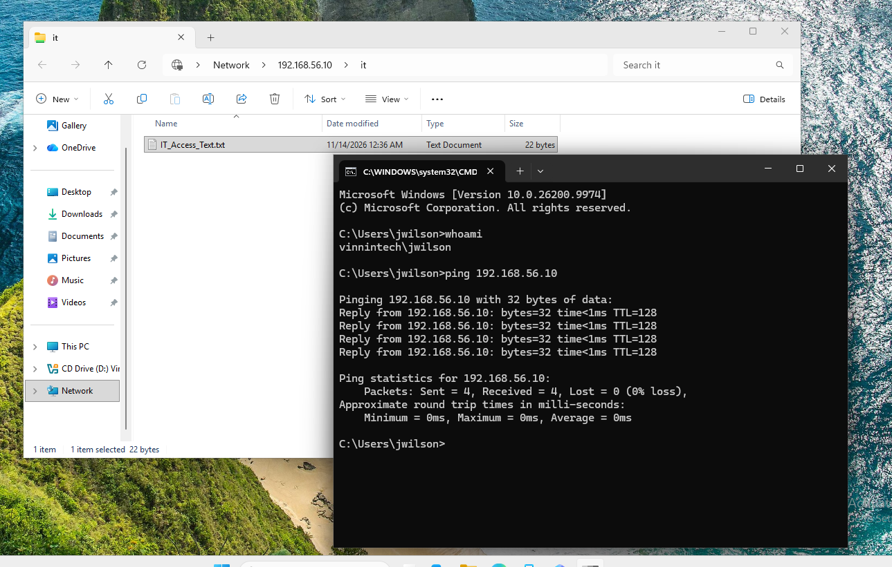

**Sarah Johnson — Human Resources**

- Authenticated using her domain account.
- Accessed the HR network share.
- Created a test file verifying departmental access.

**Michael Brown — Accounting**

- Authenticated using his domain account.
- Accessed the Accounting network share.
- Created and saved `Accounting_Access_Test.txt`.

  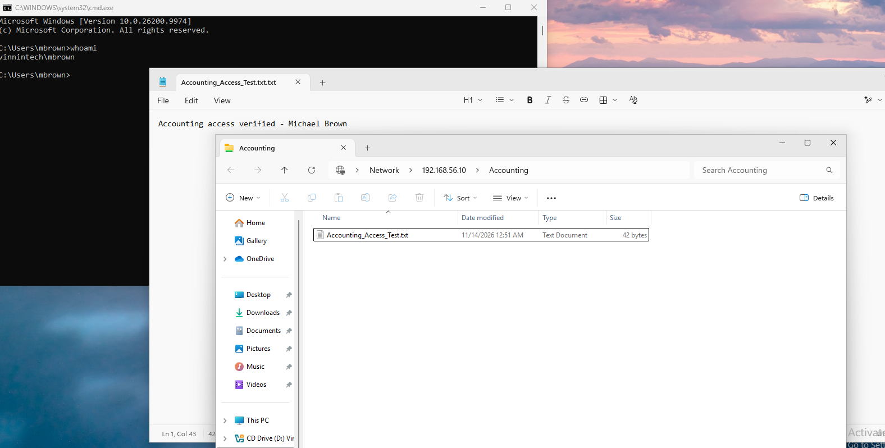

### Unauthorized Access

Verified that users could not access departmental shares outside their assigned security groups.

Examples included:

- James Wilson attempting to access the HR share.
  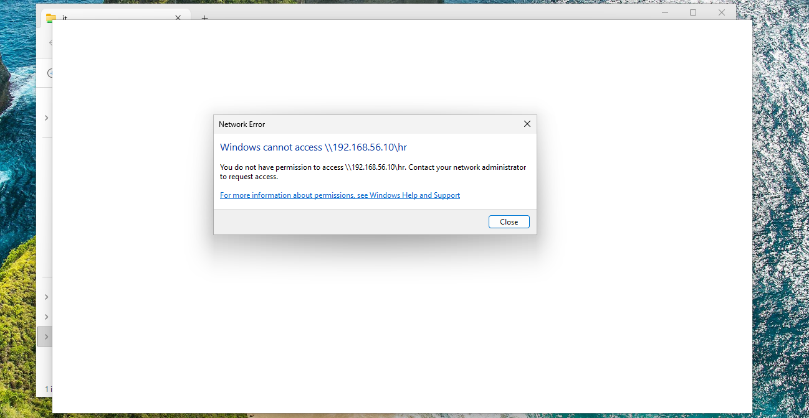
- Michael Brown attempting to access the IT share.
  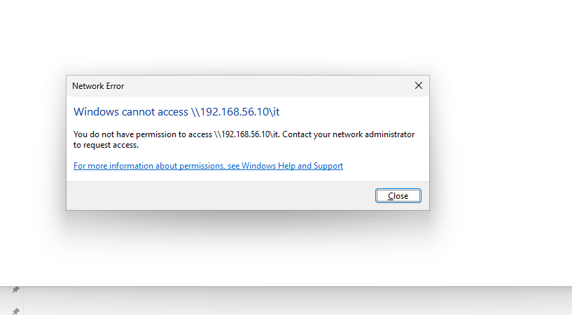

Windows returned permission-denied messages, demonstrating that departmental access restrictions were enforced.

## 7. Troubleshooting and Validation

Used Windows administrative tools and command-line utilities to validate the environment.

**Network connectivity**

Verified communication with the domain controller at `192.168.56.10` using the `ping` command.

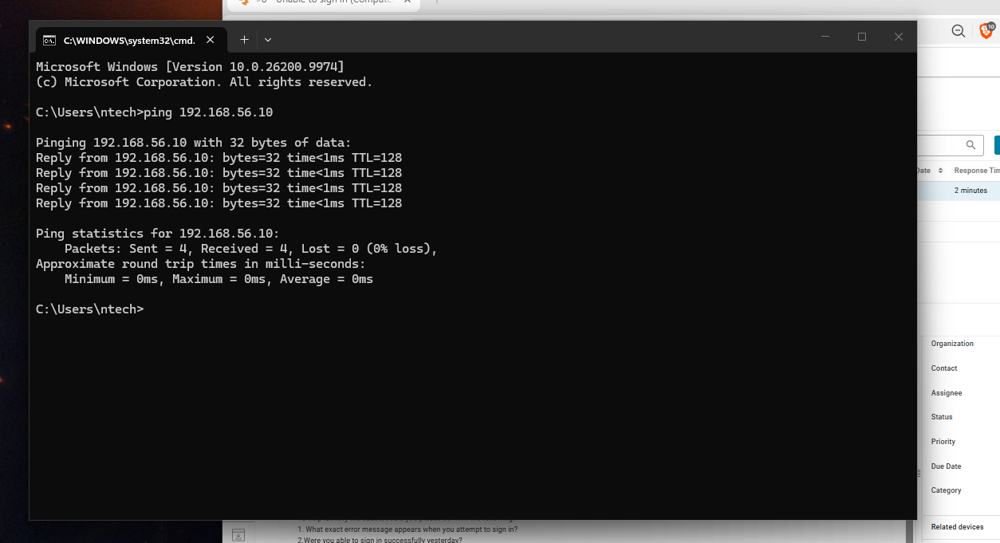

**Domain authentication**

Used `whoami` to verify the currently authenticated domain user.

**File access**

Tested access through UNC network paths and confirmed that authorized accounts could create and save files.

**Security validation**

Attempted access to unauthorized department shares to confirm that configured permissions prevented access.

## Technical Skills Demonstrated

- Windows Server 2025 Administration
- Active Directory Domain Services (AD DS)
- Organizational Unit Management
- User Account Provisioning
- Security Group Administration
- Role-Based Access Control (RBAC)
- NTFS File Permissions
- SMB Network File Sharing
- Windows Domain Authentication
- Network Connectivity Testing
- Access Control Validation
- IT Troubleshooting and Technical Documentation

## Project Outcome

Successfully implemented and tested a department-based identity and access management environment using Windows Server 2025.

The completed lab demonstrated centralized user administration, security group management, departmental file sharing, and access restrictions based on employee roles.

The project provided practical experience with Windows Server administration and common responsibilities associated with IT Help Desk, Desktop Support, and Junior Systems Administrator positions.
